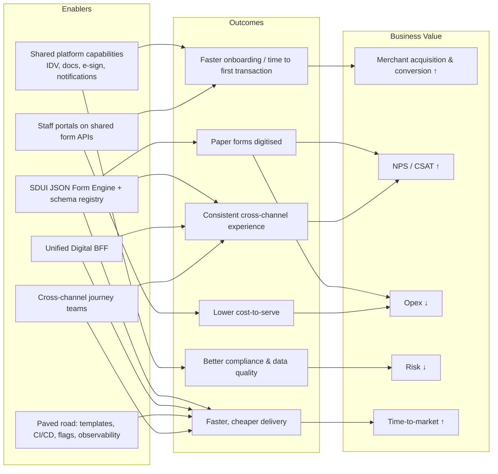

# 02 – Business Benefits

## Objectives (from the brief)
| # | Objective | Horizon |
|---|-----------|---------|
| O1 | Convert **80% of existing paper forms** into digital self-service experiences | 2 planning cycles (~6 months) |
| O2 | Increase **speed of delivery by 30%** | 2 planning cycles, sustained thereafter |
| O3 | Coherent, consistent digital experience across web and mobile, with room for channel-specific differences | Progressive, 6–24 months |
| O4 | More efficient maintenance & operations of digital channels | 12–24 months |
| O5 | Keep delivering features throughout (**zero delivery stoppage**) | Always |

## Target business capabilities

| Capability | Description | Supports |
|-----------|-------------|----------|
| **Digital Self-Service Form Engine** | Centralised JSON-schema engine that turns paper forms into web and mobile self-service flows | O1, O2 |
| **Cross-Channel Parity** | Consistent experience across channels, with native mobile extensions (e.g. camera document scanning) | O3 |
| **Staff Portal Alignment** | The same form APIs power internal staff tools, streamlining back-office operations | O1, O4 |
| **Engineering Paved Road** | Shared design system, CI/CD templates and telemetry SDK across all squads | O2, O4, O5 |

## Benefits map

## Benefits and measures (KPIs)

| Benefit | KPI | Baseline (to confirm) | 6-month target | 24-month target |
|---------|-----|----------------------|----------------|-----------------|
| Paper forms digitised | % of form submissions received digitally | ~0–10% | **≥ 80%** by volume | ≥ 95%, paper by exception |
| Faster onboarding | Application → approved (median) | Days–weeks | –30% | Same-day for simple merchants (STP) |
| Faster onboarding | Application → first transaction | TBC | –20% | –50% |
| Conversion | Onboarding start → submit completion rate | TBC | +10pp | +20pp |
| Data quality | NIGO / rework rate on applications | TBC | –40% | –70% |
| Cost-to-serve | Ops handling time per request | TBC | –25% | –60% (STP) |
| Consistency | # journeys with cross-channel parity (same rules, same data) | Low | Onboarding + top profile change forms | All in-scope journeys |
| Delivery speed | Lead time for change (commit → prod) – DORA | Baseline in month 1 | **–30%** | –50% |
| Delivery speed | Form/journey change lead time (no app release) | Weeks (app store) | Days | Hours (config) |
| Delivery efficiency | Features built once vs 3× | ~3× | 1× for in-scope journeys | 1× default |
| Release | Mobile release frequency | Monthly? | Fortnightly train | Weekly train |
| Reliability | Change failure rate / MTTR | TBC | Hold or improve | Improve 30% |
| Compliance | % profile changes with full digital audit trail | Partial | 80% | 100% |

### KPIs by subdomain (core first)

| Subdomain | Type | Lead KPIs |
|-----------|------|-----------|
| Merchant onboarding | Core | Application → first transaction; start → submit conversion; approval rate |
| Risk decisioning | Core | STP rate; referral rate; loss rate on digitally onboarded merchants |
| Profile change requests | Supporting | % changes self-served; time to effective; % with full audit trail |
| Ops case handling | Supporting | Handling time per case; NIGO/rework rate |
| Digital experience delivery | Supporting | Form change lead time; DORA lead time; features built once vs 3× |

> **Speaking point:** "30% faster delivery" needs a **baseline first** – week 1–4 action is to instrument DORA metrics and journey-level lead time; otherwise we can't prove it. The biggest lever is making ~80% of form changes **configuration, not code** – that removes the app-store and 3× build tax.

## Qualitative benefits
- **For merchants**: start anywhere, finish anywhere (save & resume across channels), pre-filled data, real-time status, fewer documents, e-signature, faster access to products.
- **For operations**: structured data (no re-keying), single work queue, automated checks, clear audit trail.
- **For product**: one journey backlog across channels; experiment (A/B) via config; channel-specific variations where valuable.
- **For engineering**: fewer bespoke stacks, reusable components and APIs, transferable skills, lower cognitive load, better observability.
- **For risk/compliance**: consistent KYC/KYB rules in the domain, immutable audit, reduced data handling of paper (privacy).

## Benefit realisation timeline
| When | What the business sees |
|------|-----------------------|
| Month 3 (end Cycle 1) | Subdomains, context map & glossary agreed; Onboarding context + stateless Unified BFF + schema registry live; top 3 onboarding forms digital on web (React runner in JSP) and native iOS/Android (~50% of paper volume); CI/CD templates + telemetry SDK established; DORA baseline published |
| Month 6 (end Cycle 2) | Profile Change context live; profile change forms (settlement account, address, directors) digital → **≥ 80%**; status from read models; JSP onboarding routes retired; staff portals use BFF form APIs; +30% delivery speed |
| Month 12 | Legacy channel BFFs consolidating into the Unified BFF; bypasses closed; STP for simple merchants; save & resume cross-channel |
| Month 18 | Leaked logic repatriated to domains; channel-specific domain APIs deprecated; event-driven updates |
| Month 24 | Legacy JSP pages & channel-specific APIs decommissioned for in-scope journeys; other domains self-serve on platform |
