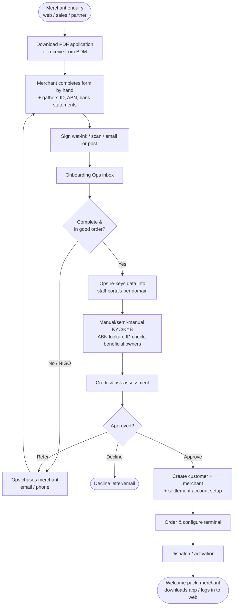
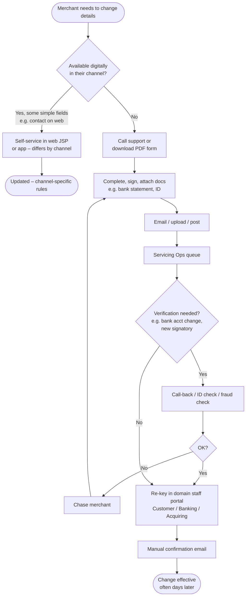
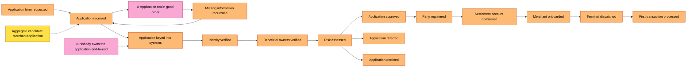

# 03 – As-Is Business Process

> Reconstructed from the brief plus typical merchant-acquirer practice. **Validate with the Product Manager in the session** – the point is to align on the shape of the process and where the waste is, not exact steps.

## Actors
| Actor | Role |
|-------|------|
| Merchant (applicant / existing customer) | Business owner, director, authorised signatory |
| Sales / Partner (e.g. POS integration partner, BDM) | Originates leads, helps merchants complete forms |
| Onboarding Ops | Receives forms, re-keys data, chases missing info |
| Risk & Compliance (KYC/KYB, credit) | AML/CTF verification, credit/fraud assessment, approval |
| Customer Service / Servicing Ops | Processes in-life change requests |
| Domain systems | Customer, Banking, Lending, Acquiring (merchant/terminal), CRM |
| Logistics | Terminal provisioning and dispatch |

---

## Process 1 – New merchant onboarding (as-is)

### Observations / waste
| # | Step | Waste (Lean) | Impact |
|---|------|-------------|--------|
| P1 | Paper form | Defects (illegible, incomplete) | High NIGO rate, rework loops |
| P2 | Email/post | Waiting, transport | Days of latency; no status visibility |
| P3 | Re-keying | Over-processing, defects | Ops cost; data errors |
| P4 | Manual KYC | Over-processing | Inconsistent decisions, slow |
| P5 | Chase loops | Waiting, motion | Abandonment; poor NPS |
| P6 | Multiple staff portals | Motion (swivel-chair) | Long handling time |
| P7 | No single case record | Information silos | No end-to-end SLA tracking, poor auditability |

---

## Process 2 – In-life profile maintenance (as-is)

Typical requests: change of business/trading name, address, contact details, **settlement bank account**, add/remove director or authorised signatory, change of ownership, add product/terminal, update MCC/business activity, close facility.

### Observations
- **Channel inconsistency**: the same change may be self-service on web, unavailable in iOS, and paper-only in Android.
- **High-risk changes** (settlement account, signatories) are paper-based partly *because* the digital channels lack step-up authentication and verification – a platform gap, not a product decision.
- No status tracking; merchants call support to check progress ⇒ extra contact volume.
- Rules for what needs verification live in ops procedures and (partially) in channel code – inconsistent.

---

## Domain events view (EventStorming input)

The same processes, written as **domain events** (past tense, business language). Run this as a big-picture EventStorming in the workshop; hot spots (🔥) mark pain and missing ownership.

| Profile change events | Owning context (target) |
|-----------------------|-------------------------|
| Change requested → Signatory verified → Change approved → Settlement account changed → Merchant notified | Profile Change (request lifecycle), Banking (settlement account) |
| Contact details changed | Customer / Party |
| Director added → Director verified | Profile Change → Customer / Party |

Hot spots found: re-keying (no owning model), NIGO loops (no invariants at capture), call-back verification (no step-up), status enquiries (no read model).

## Volume & value hypothesis (to validate)

| Form / request | Est. share of paper volume | Complexity | Candidate for |
|----------------|---------------------------|-----------|---------------|
| Merchant application (sole trader / company) | 25–35% | High (KYC/KYB, credit) | **Cycle 1** – top 3 onboarding forms; STP later (H2) |
| Settlement bank account change | 10–15% | Medium (fraud risk, step-up) | **Cycle 2** |
| Contact / address / trading name change | 15–20% | Low | **Cycle 2** (quick win; can be walking skeleton in Cycle 1) |
| Add/remove director / signatory | 5–10% | Medium–High (KYC) | **Cycle 2** |
| Additional terminal / product request | 10–15% | Low–Medium | Cycle 1 (onboarding add-on) or Cycle 2 |
| Change of ownership | < 5% | High | H2 / staff-assisted via staff portal on BFF form APIs |
| Closure / cancellation | < 5% | Medium (retention) | H2 |

> **Speaking point:** apply Pareto – typically ~6–8 forms make up ~80% of volume. Digitise those first, using a config-driven form engine so the long tail becomes cheap.
