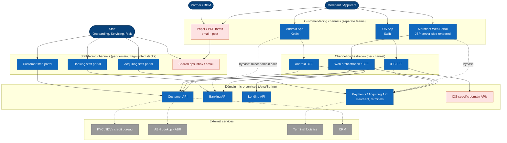
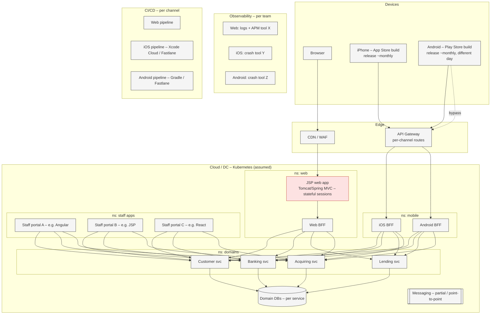
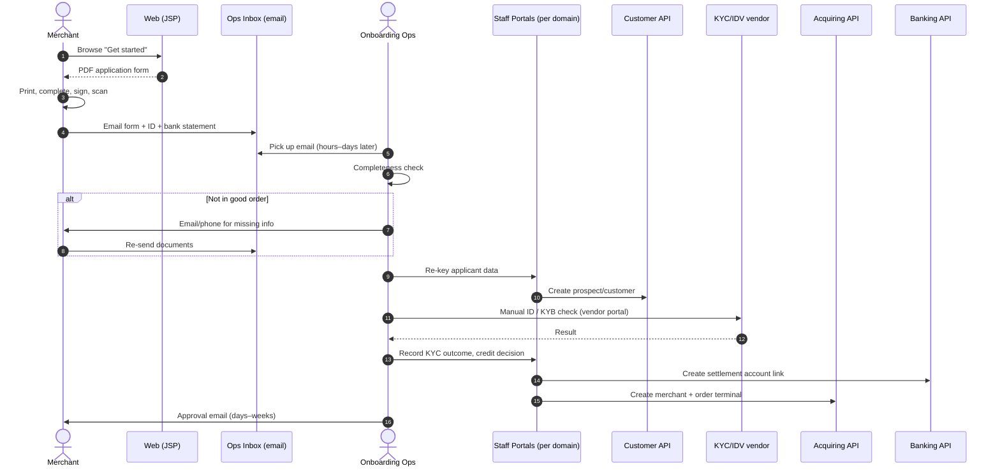
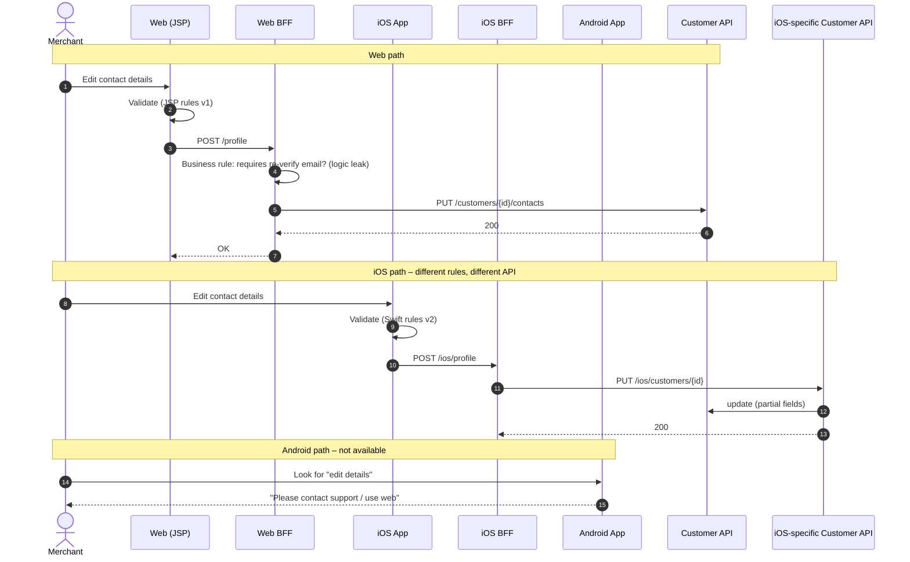
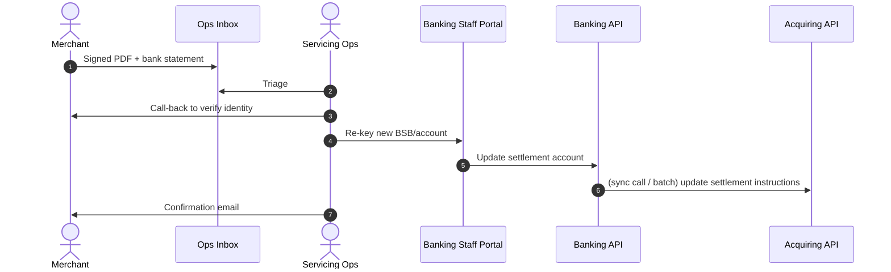

# 05 – As-Is Architecture

> Based on the brief; hosting details are assumptions (cloud Kubernetes, API gateway). **Validate with the Principal Engineer** – especially which channels bypass the BFF and where logic has leaked.

## 5.1 Context diagram (as-is)

**Pain annotations (write these on the whiteboard):**
1. Three parallel stacks → every journey built 3×.
2. Dashed "bypass" lines → no single contract, security & change coupling.
3. iOS-specific domain APIs → domain layer polluted by channel concerns.
4. Business logic in JSP / BFF / app code → divergent rules (e.g. validation, eligibility).
5. Paper → inbox → re-key → staff portal → domain. Digital channels don't reach most processes.
6. Staff portals per domain → no case view, no journey-level workflow.

## 5.2 Logical layer view – where logic sits today

| Layer | Web | iOS | Android | Issue |
|-------|-----|-----|---------|-------|
| Presentation | JSP pages + jQuery | Swift/UIKit/SwiftUI | Kotlin/Views/Compose | 3 UI codebases, 3 design systems |
| Client logic | Validation, eligibility in JSP/JS | Validation in app | Validation in app | Rules duplicated & divergent |
| Channel orchestration | Web BFF (some pages bypass) | iOS BFF + iOS-specific APIs | Android BFF (partial, some direct calls) | Inconsistent, channel-coupled |
| Domain | Customer, Banking, Lending, Acquiring | ← same | ← same | Some channel-specific endpoints; some logic missing (lives upstream) |
| Process | Email/inbox, ops procedures | – | – | No workflow/case management |

### Architectural pain points
1. **BFF bypassing** – client apps call backend domain services directly, coupling front ends to core systems.
2. **Channel-specific domain APIs** – core Java microservices host endpoints tailored to one client (e.g. iOS-only APIs).
3. **Logic leakage** – validation, orchestration and business rules are embedded in JSP pages and mobile views.

### The same pain points through a DDD lens (context-map problems)

| Symptom | DDD diagnosis |
|---------|---------------|
| Channel-specific domain APIs (iOS-only) | Domains lack an **open-host service with a published language**, so each consumer gets a bespoke contract |
| Logic leaked into JSP, apps and BFFs | **No bounded context owns** the application or change-request lifecycle, so the rules land wherever the code happens to be |
| BFF bypassing | No agreed **context map**; integration relationships are implicit and ungoverned |
| Divergent validation between channels | No **ubiquitous language** or single model; each channel has its own interpretation |
| Paper → inbox → re-key | The core onboarding subdomain has **no software model at all**; it lives in people and email |

### Engineering practice gaps
1. **Tooling silos** – Web, iOS and Android squads use different build, test, release and observability toolchains.
2. **Uncoordinated releases** – independent release cadences cause feature-parity gaps between web and mobile.
3. **Duplicated effort** – teams build the same form validation and UI layouts from scratch in three codebases.

## 5.3 Deployment diagram (as-is, assumed)

## 5.4 Sequence diagrams (as-is)

### (a) New merchant onboarding – paper

### (b) Update business contact details – channel inconsistency

### (c) Change settlement bank account – paper with call-back

## 5.5 As-is architecture assessment

| Quality attribute | Rating | Notes |
|------------------|--------|-------|
| Consistency (cross-channel) | 🔴 | Rules and APIs differ per channel |
| Changeability | 🔴 | Change × 3 channels + app release; leaked logic |
| Reuse | 🔴 | Channel-specific APIs, no shared components |
| Security | 🟠 | Bypass paths; inconsistent auth/step-up |
| Observability | 🟠 | Per-team tools; no end-to-end journey trace |
| Operability | 🟠 | Different pipelines, practices, on-call |
| Scalability / resilience | 🟢/🟠 | Domain services OK; JSP stateful sessions limit scaling |
| Compliance / audit | 🟠 | Paper & email trail; manual evidence |
