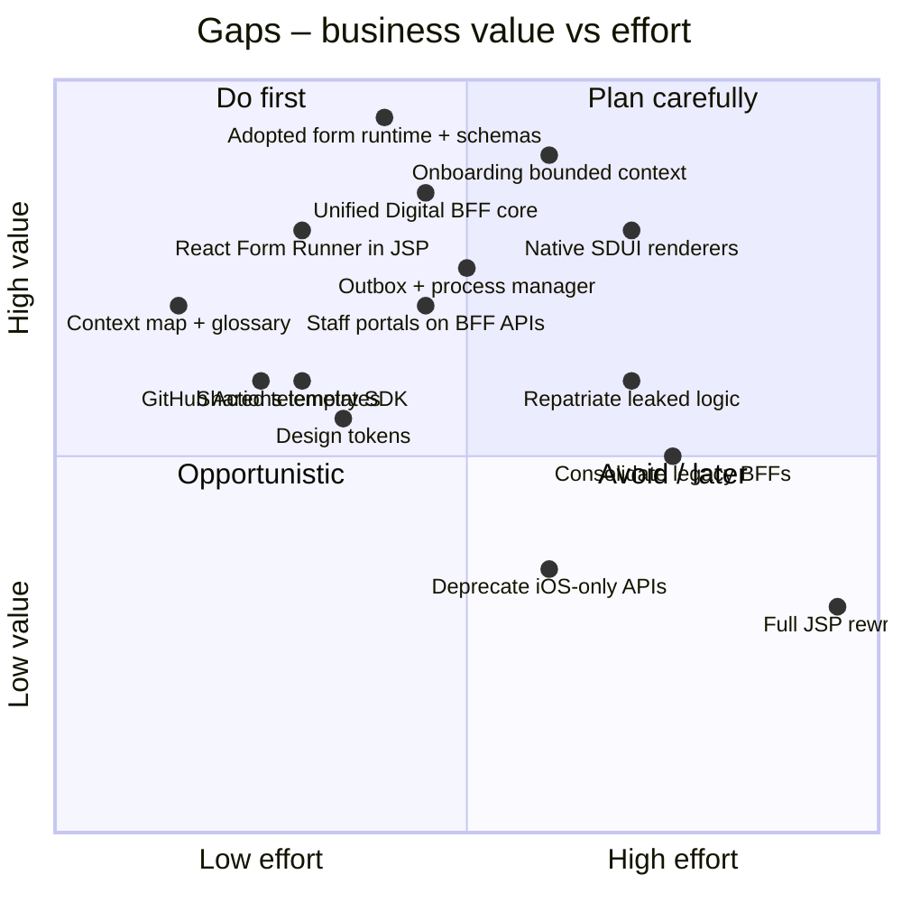

# 06 – Gap Analysis

## 6.1 Summary matrix

| Category | As-is state | Target state solution |
|----------|-------------|-----------------------|
| **Strategic design** | No subdomain classification; "domains" = teams/systems; no context map; inconsistent language | Core/supporting/generic subdomains; Merchant Onboarding & Profile Change bounded contexts; context map; ubiquitous language |
| **Functional capabilities** | Manual paper forms; form logic duplicated in each client | JSON Schema Form Engine (adopted runtime); centralised schema registry; staff portals reusing the form APIs |
| **Target architecture** | Bypassed BFFs; channel-specific domain APIs; logic in the presentation layer | Unified Digital BFF; cross-domain orchestration; Strangler React Form Runners |
| **Engineering & operations** | 3 pipeline setups; desynchronised release trains; fragmented logs | Standardised CI/CD templates (GitHub Actions); cross-platform design tokens; shared telemetry SDK |

Legend – **Priority**: M = Must (6-month goals), S = Should (12 months), C = Could (24 months).
**When**: C1 = Cycle 1 (M1–3), C2 = Cycle 2 (M4–6), H2 = M7–12, H3 = M13–24 (see [08](08-delivery-roadmap.md)).

## 6.2 Strategic design gaps

| # | Area | As-is | Target | Action | Priority | When |
|---|------|-------|--------|--------|----------|------|
| S1 | Subdomains | Not identified | Core / supporting / generic classification agreed with Product | Classify; drives build-vs-buy and logic patterns | M | C1 (week 1–2) |
| S2 | Bounded contexts | Existing "domains" only; application lifecycle has no owner | **Merchant Onboarding** and **Profile Change** contexts | Build Onboarding in C1, Profile Change in C2 | M | C1–C2 |
| S3 | Context map | None; channel-specific APIs, bypasses | Documented map: OHS + published language, partnership, ACLs | Draw & agree; publish contracts | M | C1 |
| S4 | Ubiquitous language | Terms drift across teams/docs | Glossary per context ([11](11-ubiquitous-language.md)) used in schemas, APIs, events, UI | Glossary v1; review in PRs | M | C1 |
| S5 | Build vs buy | Everything built | Buy/adopt generic (form runtime, IDV, e-sign, docs, notifications) | Time-boxed form-runtime evaluation | M | C1 (week 1–3) |
| S6 | Domain discovery | Ad hoc | EventStorming for onboarding and profile change | Big-picture then process-level sessions | M | C1 |

## 6.3 Business & process gaps

| # | Area | As-is | Target | Action | Priority | When |
|---|------|-------|--------|--------|----------|------|
| B1 | Onboarding capture | Paper/PDF, email | Digital self-service on web & mobile, save & resume | Top 3 onboarding forms on SDUI | M | C1 |
| B2 | Profile change capture | Mostly paper | Self-service in all channels, owned by the Profile Change context | Profile change forms (settlement account, address, directors) on SDUI | M | C2 |
| B3 | Back-office handling | Re-keying into domain portals | Staff portals use the same form APIs; data flows straight to domains | Expose BFF form APIs to staff portals | M | C2 |
| B4 | Status visibility | None | Status in every channel + notifications | Status API in BFF, notifications | S | C2–H2 |
| B5 | Verification (KYC/KYB) | Manual | Automated with manual exception | Verification adapter + workflow referrals | S | H2 |
| B6 | Straight-through processing | None | STP for low-risk cases | Domain decision rules + workflow | S | H2 |
| B7 | Signatures | Wet ink | E-signature, multi-party | E-sign capability | M | C1–C2 |
| B8 | Product ownership | Per channel | Per journey, cross-channel | Journey-aligned backlog & squads | M | C1 |

## 6.4 Experience gaps

| # | Area | As-is | Target | Action | Priority | When |
|---|------|-------|--------|--------|----------|------|
| X1 | Consistency | Different rules/UI per channel | Same JSON schema rendered by every channel | SDUI Form Engine | M | C1 |
| X2 | Design system | 3 separate | Tokenised design system: React, SwiftUI, Compose libraries | Design tokens → component parity | M | C1 tokens, C2 components |
| X3 | Channel-native extensions | Accidental differences | Intentional (camera document scanning, biometrics) | Schema hints + renderer capabilities | S | C1–C2 |
| X4 | Accessibility | Partial | WCAG 2.2 AA | Built into design system & renderers | M | C1+ |
| X5 | Pre-fill | None | ABN, address, known customer data pre-filled | Lookups + profile via BFF | M | C1 |

## 6.5 Application & integration gaps

| # | Area | As-is | Target | Action | Priority | When |
|---|------|-------|--------|--------|----------|------|
| A1 | Form definition | Hard-coded in 3 codebases | JSON schemas (presentation only), versioned, owned by the context team, served by the BFF | Adopt form runtime + schema registry | M | C1 |
| A2 | Channel contract | 3 BFFs, inconsistent, bypasses | **Unified Digital BFF**, stateless, for all channels + staff | BFF core in C1; legacy BFF endpoints consolidated progressively | M | C1 new, H2–H3 consolidate |
| A3 | Domain access | Clients call domains directly | Domains reachable only via the API Gateway | Close bypasses for migrated journeys first, then all | M/S | C2–H2 |
| A4 | Channel-specific domain APIs | e.g. iOS-only endpoints | Open-host services + published language | Deprecate with consumer migration; ACL meanwhile | S | H2–H3 |
| A5 | Leaked business logic | In JSP / mobile views / BFFs | Rules in bounded contexts; not in BFF or schemas | "Touch it, fix it" when a form moves to SDUI | M | C1–H3 |
| A6 | Web front end | JSP SSR | React Form Runners inside JSP → React shell via reverse proxy | Strangler Fig | M | C1 runner, C2 route retirement |
| A7 | Mobile | Hard-coded native screens | Native SDUI renderers (SwiftUI / Compose) | Renderer SDKs + component catalogue | M | C1 |
| A8 | Staff channels | Fragmented per domain | Staff portals embed the Form Runner on shared BFF APIs | Staff scopes on the BFF | M | C2 |
| A9 | Long-running processes | Email & people | Onboarding process manager (on adopted workflow engine) with compensations; Case for referrals | Process manager + Operations context | M | C1–C2 |
| A10 | Events | Partial, point-to-point | Transactional outbox + integration events (published language); idempotent consumers | Outbox for Onboarding in C1, other contexts H2 | M | C1 (onboarding), H2 (rest) |

## 6.6 Technology & platform gaps

| # | Area | As-is | Target | Action | Priority | When |
|---|------|-------|--------|--------|----------|------|
| T1 | Identity | Different auth per channel | OAuth2/PKCE via a common IdP; step-up for high-risk changes | Standardise at the BFF | M | C1 |
| T2 | CI/CD | 3 separate build/test pipelines | Unified GitHub Actions templates: lint, contract tests, security scans | Paved-road templates | M | C1 established, C2 all squads |
| T3 | Observability | Inconsistent telemetry | Shared telemetry SDK: OpenTelemetry logging/tracing, crash tracking, drop-off analytics | Telemetry SDK (web, iOS, Android, BFF) | M | C1 |
| T4 | Feature flags | Ad hoc | One flag/remote-config platform for all channels + schema rollout | Adopt one | M | C1 |
| T5 | Testing | Inconsistent | Contract tests (renderer ↔ BFF ↔ domain), schema tests, visual regression | Test strategy | M | C1–C2 |
| T6 | Security | Bypass paths | All traffic via BFF → gateway; mTLS; secrets management | Close bypasses | M | C2–H2 |

## 6.7 People & organisation gaps

| # | Area | As-is | Target | Action | Priority | When |
|---|------|-------|--------|--------|----------|------|
| P1 | Team topology | Channel squads | One team per bounded context: Onboarding squad, Profile Change squad (each owns context service + BFF module + schemas); Digital Platform team owns generic capabilities only | Onboarding squad C1, Profile Change squad C2 | M | C1–C2 |
| P2 | Skills | Channel-specific | T-shaped: schema authoring, BFF contributions, renderer expertise | Pairing, guilds, rotation | S | C1–H3 |
| P3 | Release | Web fast, mobile slow and uncoordinated | Form changes ship over the air; mobile release train for renderer/shell | SDUI + release train | M | C1–C2 |
| P4 | Metrics | Not baselined | DORA + form drop-off dashboards | Baseline in month 1 | M | C1 |
| P5 | Governance | Ad hoc | ADRs, schema/catalogue governance, BFF boundary rules | Design authority | M | C1 |

## 6.8 Value vs effort

