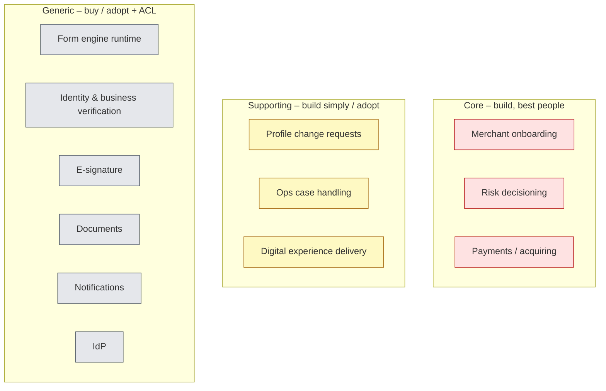
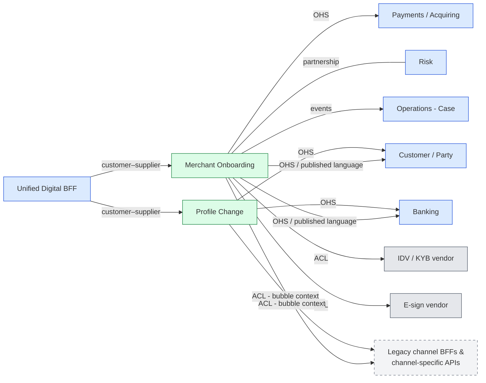
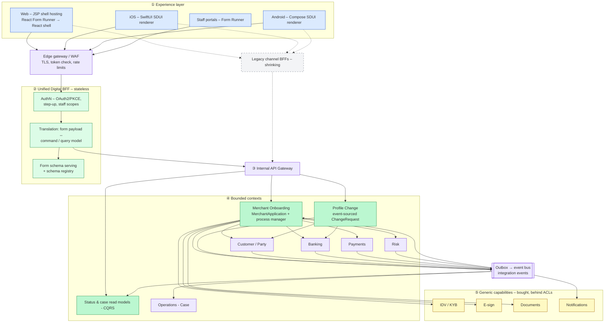
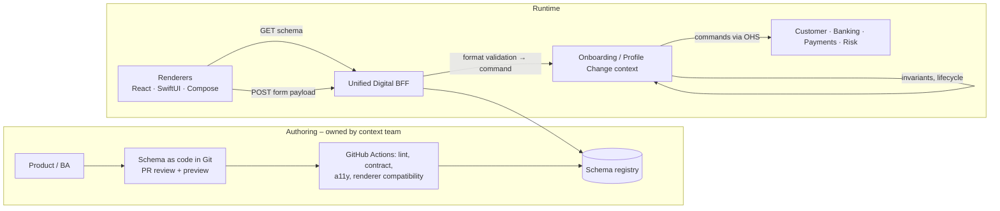
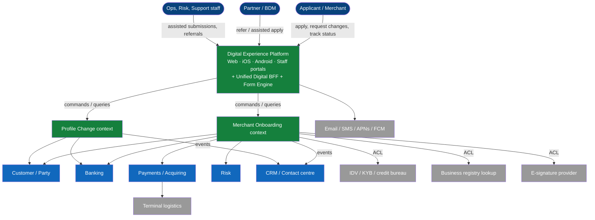
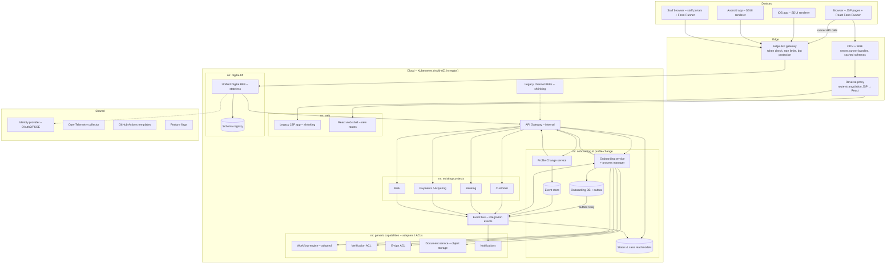
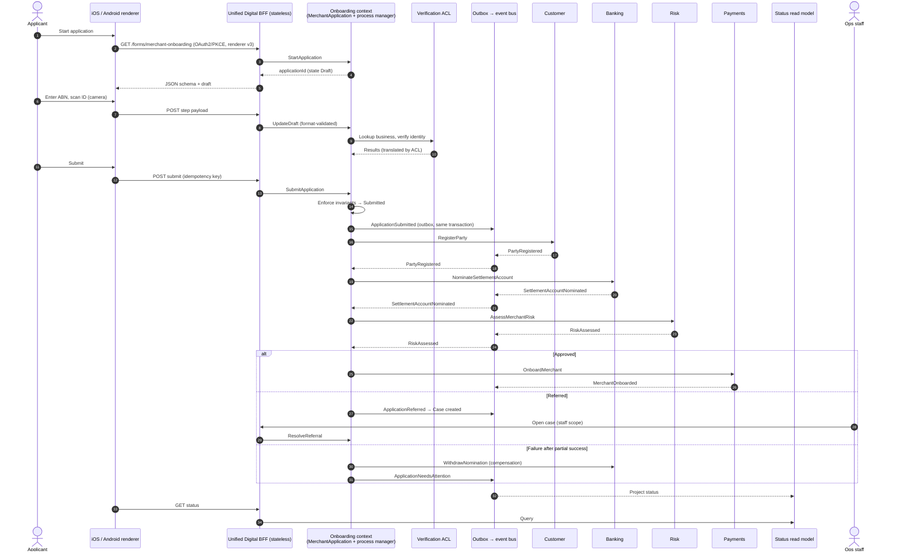
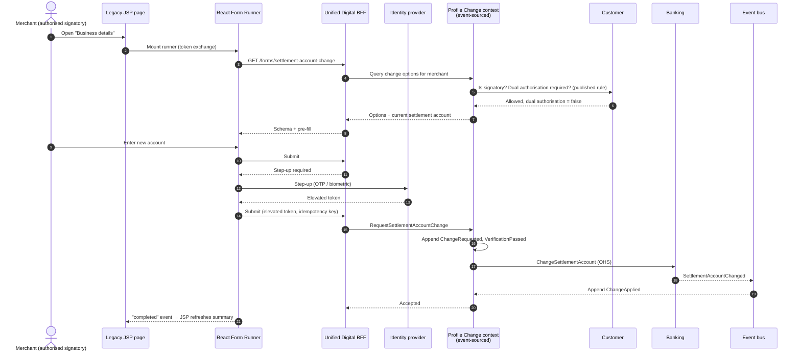
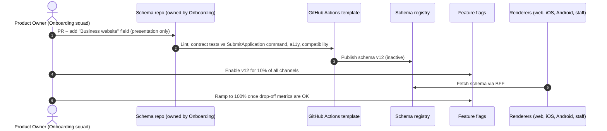

# 07 – Target Digital Architecture

The target establishes:
1. **Explicit subdomains and bounded contexts**: new **Merchant Onboarding** and **Profile Change** contexts own the application and change-request lifecycles, integrated through a documented **context map**.
2. A **Unified Digital BFF**: one *stateless* channel contract for Web, iOS, Android and staff portals.
3. A **Server-Driven UI (SDUI) JSON Form Engine**: forms defined once and rendered natively, with the runtime adopted rather than built where possible.
4. **Core domain isolation**: contexts are reachable only through the API Gateway, via open-host services with a published language.

An **Engineering Paved Road** ([09](09-engineering-roadmap.md)) sits alongside these. Terms follow the [ubiquitous language](11-ubiquitous-language.md).

## 7.1 Architecture principles

| # | Principle | Implication |
|---|-----------|-------------|
| AP1 | **Journeys, not channels** | One form definition, many renderers. Teams own journeys across channels. |
| AP2 | **Consistent by default, different by design** | Shared schema, rules and content; channel-native extensions (camera scanning, biometrics) are explicit. |
| AP3 | **Business logic belongs in bounded contexts** | UI = presentation; BFF = stateless translation (form ↔ command/query); bounded contexts = invariants, lifecycle, data of record. |
| AP4 | **Configuration over code for presentation** | Form layout and copy ship over the air; business rules do not live in schemas. |
| AP5 | **One front door to the core** | Channels talk only to the BFF; contexts are reachable only via the API Gateway as open-host services. No channel-specific APIs. |
| AP6 | **Strangle, don't rebuild** | React Form Runners inside JSP first; retire routes by reverse proxy; ACL around legacy. |
| AP7 | **Build the core, buy the generic** | Invest engineering in core subdomains; adopt/buy generic ones behind anticorruption layers. |
| AP8 | **One bounded context, one owning team** | Schemas, BFF module and context service for a journey are owned by the same team. |
| AP9 | **Reliable, observable integration** | Outbox + integration events, idempotent consumers, traces device → context. |
| AP10 | **Secure & compliant by design** | OAuth2/PKCE, step-up, event-sourced audit for profile changes, PII minimisation. |

## 7.2 Strategic design

### Subdomains

| Subdomain | Type | Why | Strategy |
|-----------|------|-----|----------|
| Merchant onboarding (time-to-first-transaction, approval rate) | **Core** | Direct growth lever; competitors compete on speed of onboarding | Build; domain model; best engineers |
| Merchant risk decisioning (STP rules) | **Core** | Balances growth vs loss; proprietary rules | Build; partnership with Onboarding |
| Payments / acquiring | **Core** | The company's primary product | Existing context |
| Profile change requests | **Supporting** | Necessary, rules are moderate, not differentiating | Build simply; event-sourced for audit |
| Operations case handling | **Supporting** | Needed for referrals and exceptions | Adopt workflow product + thin model |
| Digital experience delivery (schemas, renderer config) | **Supporting** | Enables speed, not why merchants choose us | Build thin on adopted runtime |
| Form engine runtime | **Generic** | Solved problem (JSON Forms, SurveyJS, Form.io, SDUI vendors) | **Buy/adopt**; build only native renderers if no fit |
| Identity & business verification, e-signature, documents, notifications, IdP | **Generic** | Commodity services | Buy + ACL |

### Bounded contexts & context map

| Bounded context | Owns (aggregates) | Business logic pattern | Owning team |
|-----------------|-------------------|------------------------|-------------|
| **Merchant Onboarding** (new) | `MerchantApplication` (applicants, directors, beneficial owners, documents, consents), onboarding process manager | Domain model | Onboarding squad |
| **Profile Change** (new) | `ProfileChangeRequest` (type, requested values, approvals, verification, effective date) | Event-sourced domain model (full audit history) | Profile Change squad |
| **Customer / Party** | Party, Relationship | Existing (domain model) | Customer team |
| **Banking** | Settlement Account, Nomination | Existing | Banking team |
| **Payments / Acquiring** | Merchant, Merchant facility, Terminal | Existing | Payments team |
| **Risk** | Risk assessment, decision rules | Domain model | Risk team |
| **Operations** | Case | Active record on adopted workflow product | Platform / Ops tooling |

| Relationship | Pattern | Why |
|--------------|---------|-----|
| Customer, Banking, Payments → all consumers | **Open-Host Service + Published Language** | Replaces channel-specific (iOS-only) APIs with one versioned public contract; internal models stay private |
| Onboarding ↔ Risk | **Partnership** | STP rules and the onboarding lifecycle evolve together (both core) |
| BFF → Onboarding / Profile Change | **Customer–supplier** | Channel needs drive the API; the contexts own the model |
| New contexts → vendors | **Anticorruption Layer** | Vendor models don't leak in; vendors can be swapped |
| New contexts → legacy APIs | **ACL / bubble context** | Protects new models while legacy is strangled |

## 7.3 Layered view

### Responsibility contract (the key thing to agree in the room)

| Layer | Owns | Must NOT own |
|-------|------|--------------|
| Experience (Web/iOS/Android/Staff) | Rendering, device capabilities, navigation shell, accessibility | Business rules, orchestration, direct context calls |
| Unified Digital BFF | Auth (OAuth2/PKCE), schema serving, format validation, translating form payloads into **commands** (`SubmitApplication`) and queries into renderer-shaped responses | **State** (drafts, save/resume), **orchestration** across contexts, business rules |
| Edge gateway / WAF | TLS, WAF/bot protection, token signature & expiry, rate limits | Understanding payloads |
| Internal API Gateway | Routing to contexts, service authN (mTLS), policy | Orchestration |
| Merchant Onboarding / Profile Change | Aggregates, lifecycle, invariants, drafts (save/resume = `Draft` state), process manager, compensation | Channel-specific behaviour |
| Existing contexts (Customer, Banking, Payments, Risk) | Business rules and data of record, published via OHS + integration events | Channel-specific endpoints |
| Read models (CQRS) | Status and case projections built from integration events | Writes |

## 7.4 Core components

### 1. Unified Digital BFF (stateless)
- One channel contract for Web, iOS, Android and staff portals (staff get extra scopes, same contract).
- Handles **authentication (OAuth2/PKCE)**, **schema serving**, **format validation** and **translation** between form payloads and context commands/queries.
- **Holds no state and makes no business decisions**: drafts, lifecycle and cross-context orchestration live in the Onboarding and Profile Change contexts.
- Organised by modules per bounded context. Each module is **owned by the team that owns the context** (CODEOWNERS); the platform team owns only the BFF core (auth, schema serving, observability).
- Sits **between the edge gateway and the internal API gateway**. The gateways protect and route without understanding payloads; the BFF understands the channel.
- **Pass-through test:** every endpoint must secure, serve/negotiate schemas, translate, compose or shield legacy. An endpoint that does none of these becomes a plain gateway route.
- Full rationale, options and consequences: **[ADR-001](adr/ADR-001-unified-digital-bff.md)**.

> **Pattern lineage.** The BFF is a **Backends for Frontends** (Newman) service, unified across channels. Architecturally it acts as a **Facade Controller** (Larman, GRASP): it receives system operations from every UI and delegates them to the owning bounded context. It is also a **Remote Facade** (Fowler, *PoEAA*), offering a coarse-grained interface that cuts round trips, with a **translation layer** (Adapter; like an ACL in reverse) that shields the contexts' published language from UI churn, and **API Composition** (Richardson) for read screens. Larman's warning about **bloated controllers** is exactly our logic-creep risk, and his fix, **use-case controllers**, is our split into modules per bounded context. Where the analogy stops: facades and controllers are in-process object patterns, whereas the BFF is a deployed, network-facing service that also carries security, version negotiation and resilience.

### 2. SDUI "JSON Form Engine"
- The BFF serves a **JSON Schema** defining form structure, field types, **format validation**, step order and conditional display.
- **Build vs buy (generic subdomain):** adopt an open-source or commercial runtime for the schema format and web runner (evaluate JSON Forms, SurveyJS, Form.io, SDUI vendors in weeks 1–3). Build only what has no fit, most likely the native SwiftUI/Compose renderers against the adopted schema format.
- **Mobile:** native renderers with design-system primitives; native extensions (camera document scanning) declared as schema hints.
- **Web (hybrid Strangler Fig):** legacy JSP pages host **React Form Runners** consuming the same schemas; routes move to a React shell behind a reverse proxy later.
- **Staff portals** embed the same runner for assisted submissions and referrals.
- **Version negotiation:** renderers advertise their component-catalogue version; the BFF serves a compatible schema or a web fallback.

**Schemas vs business rules:**

| Lives in the schema (presentation) | Lives in the bounded context (authoritative) |
|------------------------------------|---------------------------------------------|
| Required, pattern, length, formats | Invariants (e.g. all beneficial owners verified before submission) |
| Conditional display, **derived from rules the context publishes** (e.g. `entityType=trust → show trustee section`) | The rule itself, re-checked on every command |
| Labels, help text, ordering | Eligibility, dual authorisation, risk thresholds |

Schemas are the **published language of their bounded context**: the Onboarding squad owns the onboarding schemas, and the Profile Change squad owns the change-request schemas.

### 3. Merchant Onboarding context
- `MerchantApplication` aggregate with lifecycle *Draft → Submitted → Verifying → Referred → Approved / Declined / Withdrawn*. Save & resume is simply the `Draft` state, so any channel can resume it.
- An **onboarding process manager** (hosted on the adopted workflow engine) sends commands to Customer, Banking, Risk and Payments, reacts to their integration events, and runs **compensating actions** on failure.
- Changes are published through a **transactional outbox**; consumers are idempotent.
- **ACLs** wrap the IDV/KYB and e-sign vendors, and any legacy API still needed during transition.

### 4. Profile Change context
- `ProfileChangeRequest` aggregate, **event-sourced**, so the full history (who requested, who approved, verification outcome, effective date) is the audit trail regulators need.
- Applies changes to the owning context (Customer, Banking) via its OHS, and publishes integration events (`SettlementAccountChanged`).

### 5. Read models (CQRS)
- **Application status** and **ops case views** are projections built from integration events. Merchants (on any channel) and staff see the same status, and the BFF doesn't fan out to four contexts per status request.

### 6. Core domain isolation
- Customer, Banking and Payments stay pure execution systems, reachable **only via the API Gateway** as **open-host services with a published language**.
- Rules such as dual authorisation are **published by the owning context** and called, never re-implemented.

## 7.5 Context diagram (target)

## 7.6 Key design decisions & trade-offs

| # | Decision | Options considered | Decision & justification | Trade-off |
|---|----------|-------------------|--------------------------|-----------|
| D1 | **SDUI schemas vs hard-coded native views** | (a) Native ×3 (b) Cross-platform rewrite (c) Webview (d) **SDUI JSON schemas + native renderers** | **(d).** Forms are a bounded component set. Over-the-air schema updates bypass app-store bottlenecks and drive the 30% speed gain. | Renderer investment; schema governance; keep scope to forms |
| D2 | **Build vs buy the form engine** (generic subdomain) | (a) Build all (b) **Adopt schema format + web runner; build native renderers only if no fit** (c) Full commercial SDUI platform | **(b), decided by week 3 after a time-boxed evaluation.** Engineering effort goes to core subdomains; lowers Cycle 1 risk. | Some constraints from the adopted format; vendor/OSS dependency behind an adapter |
| D3 | **Hybrid Strangler Fig web vs full JSP rewrite** | Rewrite vs **React Form Runners inside JSP → reverse-proxy route retirement** | Strangler: no "stop-the-world" rebuild; delivery continues. | JSP shells with React islands for a while |
| D4 | **Unified Digital BFF vs per-channel BFFs / direct access / gateway logic** ([ADR-001](adr/ADR-001-unified-digital-bff.md)) | No BFF, 3 BFFs, logic in gateway, GraphQL, **one Unified BFF** | **One Unified BFF, kept stateless, between edge and internal gateways.** Channel concerns solved once; stable contracts; removes channel-specific endpoints. | One extra hop; must police that no state or rules creep in |
| D5 | **Where the application lifecycle lives** | (a) In the BFF (b) **Dedicated Merchant Onboarding / Profile Change bounded contexts** | **(b).** The lifecycle and invariants are core business logic, so they need an aggregate owned by the business-aligned team. | Two new services to build in Cycle 1–2 |
| D6 | **Cross-context consistency** | (a) Parallel synchronous calls ("payload splitting") (b) **Process manager + outbox + idempotent consumers** | **(b).** Partial failures are handled with compensations; state changes are never lost. | Eventual consistency, so status shows "in progress" states |
| D7 | **Audit for profile changes** | State-based + audit table vs **event-sourced aggregate** | **Event sourcing.** The history *is* the audit evidence. | Team needs event-sourcing skills; projections to maintain |
| D8 | **Status views** | Query every context vs **CQRS read models** | Read models: one consistent status for merchants and staff, cheap reads. | Eventual consistency; projection rebuilds |
| D9 | **Staff portals reuse the customer form APIs** | Separate staff tools vs **same schemas/commands with staff scopes** | Same schemas and commands: one definition for self-service *and* assisted handling; removes re-keying. | "On behalf of" authorisation and audit |
| D10 | **Integration with legacy and vendors** | Direct use vs **ACL** | ACL: the new models stay clean; vendors can be swapped. | Translation code to maintain |
| D11 | **Identity** | Per-channel auth vs **OAuth2 + PKCE via common IdP, step-up for high-risk changes** | Common IdP | Migrating sessions (JSP ↔ React runner SSO) |

## 7.7 Deployment diagram (target)

**Non-functional notes:** in-country data residency; encryption at rest and in transit (mTLS); latency budget for the BFF hop; idempotency keys end-to-end; outbox for every state change; graceful degradation (the application stays in `Draft`/`Submitted` if a downstream context is unavailable, and the process manager retries).

## 7.8 Sequence diagrams (target)

### (a) New merchant onboarding – native SDUI + process manager

### (b) Change settlement account – React Form Runner in JSP, event-sourced change request

### (c) Form change over the air – no app release

> If the new field changes a **rule** (e.g. website required for online merchants), the change goes to the Onboarding context first and the schema reflects the rule it publishes.

## 7.9 Risk & mitigation matrix

| Risk | Severity | Mitigation |
|------|----------|-----------|
| **State or business rules creep into the BFF** | High | Stateless-BFF rule; architecture fitness tests (no DB, no calls to more than one context per request); design-authority review |
| **Business rules creep into schemas** | High | Schema = presentation; rules published by contexts; contract tests between schema and command |
| **Two new bounded contexts too much for Cycle 1** | Medium | Onboarding context in Cycle 1 (core); Profile Change in Cycle 2; start with a lean aggregate and grow |
| **Eventual consistency confuses users** | Medium | Explicit in-progress statuses; notifications on completion |
| **Event-sourcing skills gap** | Medium | Pair with experienced engineers; limit to Profile Change; adopt a proven library |
| **Adopted form runtime doesn't fit native** | Medium | Time-boxed evaluation; adapter layer; build native renderers against the adopted schema |
| **Mobile app-store delays** | Medium | SDUI over-the-air presentation changes |
| **Legacy web compatibility** | Medium | React runner isolated (Shadow DOM, own bundle) inside JSP |
| **Old app versions can't render new schemas** | Medium | Version negotiation, min-version policy, web fallback |
| **Fraud on digital high-risk changes** | High | Step-up auth, account verification, change notifications, fraud monitoring |
