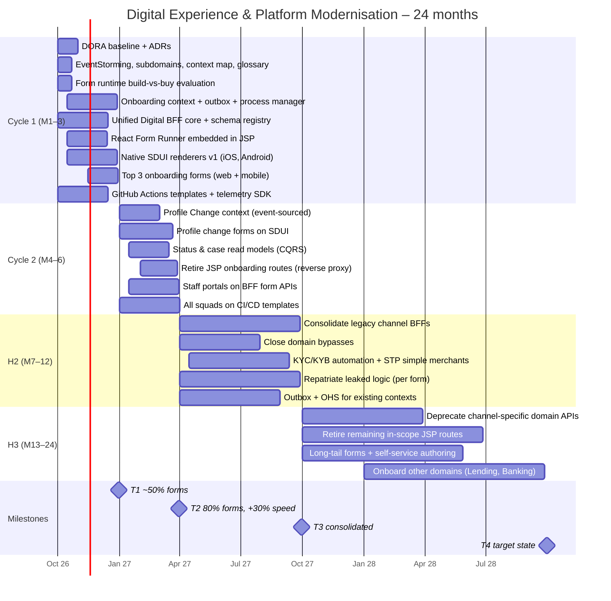
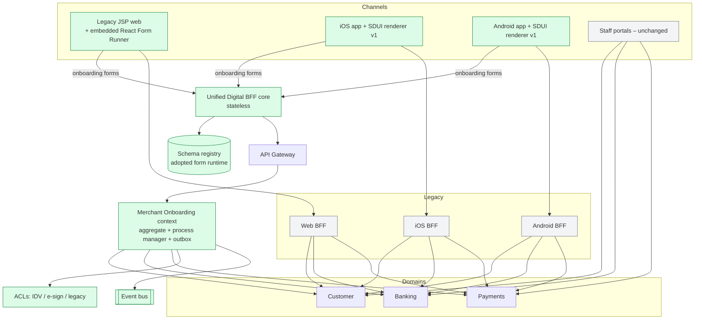
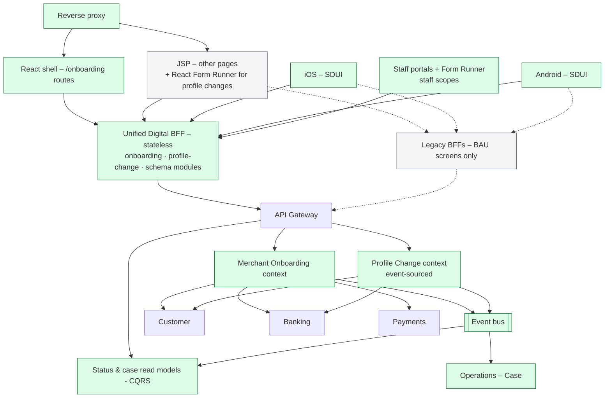

# 08 – Delivery Roadmap & Transition Architectures

Modernisation runs incrementally using the **Strangler Fig Pattern** so **business delivery never stops**. The plan has three parts:
- **Horizon 1 (M1–6):** two 3-month planning cycles that deliver the business targets
- **Horizon 2 (M7–12):** consolidation
- **Horizon 3 (M13–24):** reaching the target state and scaling the platform

Each transition architecture (T1–T4) is a **stable, releasable state**: the programme could pause at any of them and still keep the value delivered.

| Transition | When | Theme |
|-----------|------|-------|
| **T1** | End of Cycle 1 (M3) | Platform foundation, Onboarding context & high-volume onboarding (~50% of forms) |
| **T2** | End of Cycle 2 (M6) | Profile changes & staff integration (**≥ 80%**, +30% speed) |
| **T3** | M12 | Consolidation – legacy BFFs folded in, bypasses closed, automation |
| **T4** | M24 | Target state – legacy retired, platform self-service for other domains |

## 8.1 Roadmap overview

## 8.2 Horizon 1 – two-cycle (6-month) execution plan

### Cycle 1 (Months 1–3): Platform foundation & high-volume onboarding
0. **Weeks 1–3 – strategic design:** EventStorming on onboarding and profile change; agree core/supporting/generic subdomains, the context map and glossary v1 ([11](11-ubiquitous-language.md)); time-boxed **build-vs-buy** decision for the form runtime.
1. Deploy the **Unified Digital BFF core** (stateless) and the **JSON Schema Registry** on the adopted form runtime.
2. Build the **Merchant Onboarding bounded context**: `MerchantApplication` aggregate, process manager, **transactional outbox**, ACLs to IDV/e-sign.
3. Embed the **React Form Runner** container inside the legacy JSP web shell.
4. Digitise the **top 3 high-volume merchant onboarding** paper forms on web & mobile (**~50% of form target reached**).
5. Establish unified **CI/CD templates** (GitHub Actions) and the shared client **telemetry SDK**.

### Cycle 2 (Months 4–6): Profile changes & staff integration
1. Build the **Profile Change bounded context** (event-sourced `ProfileChangeRequest`) and convert **profile change** forms (settlement account, address, directors) to SDUI (**reaches the 80%+ conversion target**).
2. Add **CQRS read models** for application/change status and staff case views.
3. **Retire legacy JSP onboarding routes** via reverse-proxy URL strangulation.
4. **Expose the Digital BFF form APIs to staff portals** (assisted submissions, referrals), replacing re-keying for these forms.
5. Complete **cross-squad adoption** of standardised CI/CD pipelines.

> **Why onboarding first?** It is a **core subdomain** and the highest-volume form set (growth + drop-off), and it exercises every platform component (schema, BFF, process manager, outbox, documents, verification). Investing in core first follows DDD guidance. Profile changes (a supporting subdomain) then reuse a proven platform, which makes Cycle 2 faster.
>
> **De-risking week 1–6:** ship one low-risk form (e.g. contact details) as a **walking skeleton** through BFF → gateway → context on all three channels before the onboarding forms land.

## 8.3 Transition architecture T1 (M3) – "Platform foundation"

**True at T1:** new onboarding forms run on the new stack in all three channels, and the application lifecycle lives in the **Onboarding context**, not the BFF. Cross-context steps run through the process manager with outbox events. Everything else stays on the legacy BFFs, so BAU delivery is untouched. Referrals are still handled in the existing staff portals.

## 8.4 Transition architecture T2 (M6) – "Profile changes & staff integration"

**True at T2:** ≥ 80% of paper volume is digital. Both new bounded contexts are live, and status is served from read models. JSP onboarding routes are retired, and staff handle the same forms (assisted or referred) through the BFF, with cases raised from events. All squads are on the paved-road pipelines.

## 8.5 Transition architecture T3 (M12) – "Consolidation"
- Legacy channel BFF endpoints for customer-profile and onboarding-adjacent screens are folded into the Unified BFF modules; remaining BFF scope is small and scheduled for removal.
- **Direct domain bypasses closed**: all client traffic goes through BFF → API Gateway.
- Leaked rules for migrated forms are repatriated into their owning bounded contexts, with parity tests.
- Existing contexts (Customer, Banking, Payments) expose **open-host services with a published language** and publish integration events via outbox.
- KYC/KYB automation and **STP for low-risk merchants** (Onboarding ↔ Risk partnership).

## 8.6 Transition architecture T4 (M24) – "Target state" (see [07](07-target-architecture.md))
- Channel-specific domain APIs (e.g. iOS-only) are **deprecated and removed**; the legacy ACLs are removed with them.
- Remaining in-scope JSP routes are retired; web runs on the React shell.
- Long-tail forms are digitised through **self-service schema authoring** with governance guardrails.
- Other domains (Lending applications, Banking account opening) adopt the BFF + Form Engine paved road, each with its own bounded context.
- Subdomain classification reviewed (e.g. if STP becomes routine, parts of risk decisioning may move from core to supporting).

## 8.7 Risks, dependencies & constraints (RAID)

| Type | Item | Mitigation |
|------|------|-----------|
| Risk | Native SDUI renderers not ready for Cycle 1 | Minimal component catalogue; walking skeleton by week 6; contingency: Form Runner in webview for a specific form |
| Risk | State or business logic creeps into the BFF or schemas | Stateless-BFF rule, fitness tests, schema = presentation only, design-authority review |
| Risk | Two new bounded contexts stretch Cycle 1–2 capacity | Onboarding (core) in C1, Profile Change in C2; lean aggregates first |
| Risk | Adopted form runtime doesn't fit native renderers | Time-boxed evaluation; adapter; build native renderers against adopted schema |
| Risk | 80% target misread (form count vs volume) | Agree volume-based measure with Product in week 1 |
| Risk | BAU demand starves platform capacity | Ring-fenced platform team; squads split new/BAU capacity |
| Risk | Old app versions can't render new schemas | Version negotiation, min-version policy, web fallback |
| Risk | Staff portals' tech diversity slows Form Runner adoption | Runner shipped as framework-agnostic web component |
| Dependency | Identity provider supports PKCE + step-up | Early engagement; OTP fallback |
| Dependency | Existing contexts accept commands (RegisterParty, NominateSettlementAccount) and publish events | Joint planning; ACL over current APIs until OHS is ready |
| Dependency | Vendors (IDV, e-sign) | Adapters; decide by week 6 |
| Constraint | Zero delivery stoppage | Strangler Fig, feature flags, legacy BFFs kept for BAU |
| Constraint | Regulatory (AML/CTF, prudential, privacy) | Compliance in design authority; audit by design |

## 8.8 Governance & exit criteria
- **Per cycle:** transition architecture review; benefits tracking (digital form %, DORA, drop-off, ops handling time).
- **Fortnightly:** design authority – ADRs, context map and glossary changes, schema/catalogue changes, BFF boundary checks.
- **T1 exit:** subdomains, context map and glossary v1 agreed; Onboarding context live with outbox; top 3 onboarding forms live on 3 channels; ~50% of paper volume digital; templates and telemetry SDK live; zero Sev1 from the new stack.
- **T2 exit:** Profile Change context and read models live; ≥ 80% of paper volume digital; JSP onboarding routes retired; staff portals on BFF APIs; −30% lead time vs baseline.
