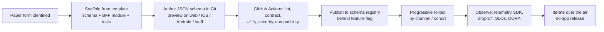

# 09 – Engineering Roadmap & Paved Road (aligned to T1–T4)

The architecture only lands if the **way we build** changes with it. To achieve the **30% delivery velocity increase**, engineering practices are unified around shared capabilities, phased to match the transition architectures in [08](08-delivery-roadmap.md).

## 9.1 Paved-road capabilities

| Capability area | As-is | Target "paved road" solution |
|-----------------|-------|------------------------------|
| **Form engineering** | Built 3× (JSP, Swift, Kotlin) | **JSON Schema Form Engine** on an **adopted runtime** (generic subdomain) – configured once, served by the BFF, rendered cross-platform |
| **Design system** | Fragmented UI components | **Tokenised design system** – standardised React, SwiftUI and Jetpack Compose libraries from one token source |
| **CI/CD tooling** | 3 separate build/test pipelines | **Unified GitHub Actions templates** – automated linting, contract tests, security scans (SAST/SCA), build & release |
| **Observability** | Inconsistent telemetry | **Shared telemetry SDK** – OpenTelemetry logging & tracing, crash tracking, form drop-off analytics |
| **BFF development** | Per-channel BFF patterns | **Stateless BFF module template** – auth, format validation, form ↔ command translation, contract tests; fitness tests forbid state and multi-context orchestration |
| **Bounded context service** | Ad hoc | **Context service template** – aggregate skeleton, transactional outbox, idempotent consumer, OHS/OpenAPI + AsyncAPI, ACL module |
| **Release** | Web fast, mobile ad hoc | **Over-the-air schema releases** behind feature flags + **mobile release train** for renderer/shell |

## 9.2 Team topology evolution

```mermaid
flowchart LR
  subgraph Now["As-is – channel squads"]
    W[Web squad – JSP]
    I[iOS squad]
    A[Android squad]
    D1[Domain teams]
  end
  subgraph H1["Horizon 1 – journey squads + platform"]
    JO[Onboarding squad<br/>owns Onboarding context ·<br/>BFF module · schemas]
    JM[Profile Change squad<br/>owns Profile Change context ·<br/>BFF module · schemas]
    DP[Digital Platform team<br/>BFF core · adopted form runtime · renderers ·<br/>design system · paved road]
    CH[Channel shell squads – BAU,<br/>app shell, native extensions]
    D2[Domain teams – own APIs & rules]
  end
  subgraph Later["H2–H3 – platform as a product"]
    J1[Journey squads ×N<br/>incl. Lending, Banking]
    P1[Digital Platform – product-managed,<br/>SLOs, self-service]
    CS[Web / iOS / Android guilds]
    D3[Domain platform teams]
  end
  Now --> H1 --> Later
```

| Team type | Responsibility | Formed |
|-----------|----------------|--------|
| **Journey squads** (stream-aligned) | **One bounded context each**: the context service, its BFF module (CODEOWNERS), its schemas (published language), UX and drop-off metrics | Cycle 1 (Onboarding – core), Cycle 2 (Profile Change – supporting) |
| **Digital Platform team** | Generic & supporting capabilities only: BFF core, adopted form runtime + schema registry, renderers, design system, paved-road templates. Owns no business rules | Cycle 1 |
| **Enabling – DevEx/SRE** | GitHub Actions templates, telemetry SDK, coaching squads onto the paved road | Cycle 1 (time-boxed per squad) |
| **Channel shell squads** | App shell, navigation, native extensions (camera scanning, biometrics), store releases, BAU | Continue from today's channel squads |

## 9.3 Engineering roadmap by transition

| Track | T1 – Cycle 1 (M1–3) | T2 – Cycle 2 (M4–6) | T3 – H2 (M7–12) | T4 – H3 (M13–24) |
|-------|---------------------|---------------------|-----------------|------------------|
| **BFF** | Stateless core + onboarding module; OAuth2/PKCE; schema serving; form ↔ command translation | Profile Change module; staff scopes; step-up; idempotency keys | Absorb legacy BFF endpoints; close bypasses; fitness tests for boundary rules | Legacy BFFs decommissioned; module self-service for other domains |
| **Form engine** | Build-vs-buy decision (week 3); adopted schema format + web runner; registry; native catalogue v1 (~15 components) | Conditional logic v2, save & resume, renderer version negotiation | Experiments on schema variants; analytics built in | Self-service authoring UI with governance |
| **Bounded contexts** | Onboarding context: `MerchantApplication` aggregate, process manager, outbox, ACLs | Profile Change context (event-sourced); CQRS status & case read models | Existing contexts expose OHS + integration events; legacy ACLs shrink | Contexts for other domains (Lending, Banking) on the same template |
| **Web** | React Form Runner as isolated container inside JSP; SSO/token exchange | React shell + reverse proxy; JSP onboarding routes retired; runner packaged as web component for staff portals | More JSP routes strangled | In-scope JSP retired |
| **Mobile** | SwiftUI & Compose SDUI renderers v1; camera scanning extension | Renderer v2 (catalogue parity); fortnightly release train | Weekly train; automated store submission | Renderer SDKs stable, versioned, compatibility-tested |
| **Design system** | Token pipeline (one source → CSS, Swift, Kotlin) | Component libraries at parity for form components | Beyond forms (shell, navigation) | Shared across customer & staff channels |
| **CI/CD** | GitHub Actions templates: lint, unit, contract, SAST/SCA, build; trunk-based dev | All squads adopted; schema pipeline (lint, a11y, compatibility) | Progressive delivery; automated rollback | Continuous delivery; on-demand schema releases |
| **Testing** | Strategy per logic pattern (§9.5); contract tests renderer ↔ BFF ↔ context (Pact); schema ↔ command contract tests | Visual regression across renderers; accessibility automation | Parity tests for repatriated rules; resilience tests | Synthetic journeys in production |
| **Observability** | Shared telemetry SDK (OTel) in web, iOS, Android, BFF; DORA dashboard; drop-off funnels | SLOs per form journey; unified crash/RUM | Business KPIs (STP rate, ops time) on same dashboards | Platform SLO reporting; cost observability |
| **Security** | PKCE, secrets management, threat model per form | Step-up auth; staff "on behalf of" audit | Bypasses closed; mTLS everywhere | Continuous compliance evidence |
| **Skills & culture** | EventStorming facilitation; DDD tactical patterns (aggregates, outbox, sagas); ADRs; glossary in PR reviews | Event-sourcing pairing for Profile Change; platform rotation | Guilds (web/iOS/Android) own renderer quality | Career paths for platform & journey engineers |

## 9.4 The golden path for a new form

Goal: a new form goes **from paper to production on all channels in ≤ 2 weeks**.

## 9.5 Testing strategy by business-logic pattern

Following *Learning Domain-Driven Design* (ch. 10), the test shape follows the logic pattern:

| Component | Logic pattern | Test shape | Emphasis |
|-----------|---------------|-----------|----------|
| Merchant Onboarding context | Domain model | **Pyramid** | Many unit tests on aggregate invariants and process-manager transitions; fewer integration tests |
| Profile Change context | Event-sourced domain model | **Pyramid** | Given-events / when-command / then-events tests; projection tests |
| Operations case, schema registry | Active record | **Diamond** | Integration tests dominate (persistence + behaviour) |
| Unified Digital BFF | Transaction script (translation) | **Reversed pyramid** | End-to-end and contract tests (renderer ↔ BFF ↔ context) |
| Renderers | UI | Component + visual regression + a11y | Schema compatibility matrix across renderer versions |

## 9.6 How we reach +30% delivery speed

| Lever | Contribution | Measure |
|-------|-------------|---------|
| Build once, render everywhere (Form Engine) | Largest – removes duplicated effort across three codebases | Effort per form |
| Over-the-air schema updates | Removes the app-store wait for form changes | Form change lead time |
| Unified GitHub Actions templates | Faster, consistent pipelines; less setup per squad | DORA lead time, deploy frequency |
| Contract tests + shared telemetry | Fewer integration defects; faster diagnosis | Change failure rate, MTTR |
| Journey squads | Fewer cross-team hand-offs | Cycle time per story |

> Baseline DORA metrics in **month 1**; report every month. Target −30% lead time and +30% throughput on in-scope work by month 6.

## 9.7 Engineering milestones

| Milestone | Exit criteria |
|-----------|---------------|
| Week 3 | EventStorming done; subdomains, context map, glossary v1 agreed; form-runtime build-vs-buy decided |
| Week 4 | DORA baseline; ADRs D1–D6 agreed; platform team and Onboarding squad formed |
| Week 6 | Walking skeleton: one form live via BFF → gateway → Onboarding context (with outbox) on web, iOS, Android, traced end-to-end |
| T1 (M3) | Top 3 onboarding forms live; templates + telemetry SDK used by platform & onboarding squads |
| T2 (M6) | Profile Change context + read models live; 80% form volume digital; all squads on templates; −30% lead time |
| T3 (M12) | Legacy BFF endpoints consolidated; bypasses closed; weekly mobile train |
| T4 (M24) | Channel-specific APIs removed; platform self-service; ≥ 2 other domains onboarded |

## 9.8 Engineering risks

| Risk | Mitigation |
|------|-----------|
| Platform team becomes a bottleneck | Context teams own their BFF modules and schemas (CODEOWNERS); platform owns only generic capabilities |
| DDD skills gap (aggregates, event sourcing, sagas) | Training, pairing, EventStorming practice, context service template |
| Renderer bugs affect many forms at once | Strong renderer test suite, staged rollout, kill-switch to previous schema |
| Channel engineers resist the cross-channel model | Start with volunteers; specialists own renderers & native extensions |
| Running two stacks (JSP + React, legacy BFFs + Unified BFF) | Time-boxed coexistence; decommission milestones tracked like features |
| Tooling sprawl continues | GitHub Actions templates are the easiest path; design authority standards |
