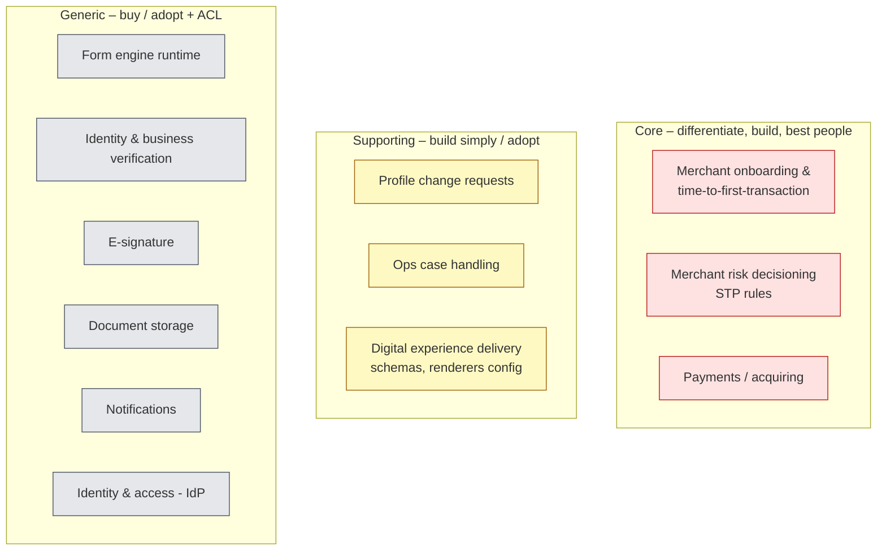
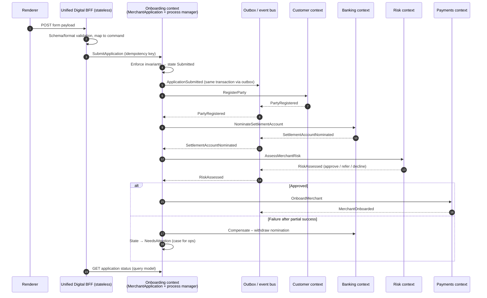
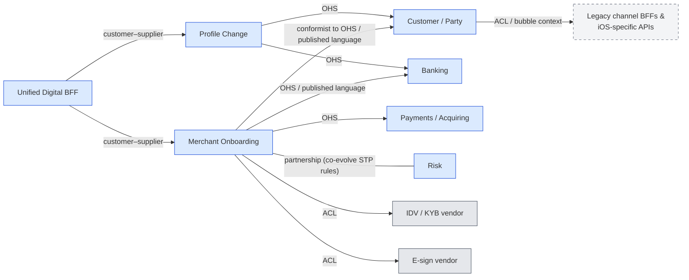

# 10 – Domain-Driven Design Review of the Architecture Pack

**Reference:** Vlad Khononov, *Learning Domain-Driven Design: Aligning Software Architecture and Business Strategy* (O'Reilly, 2021).
Chapter references are to the book's structure (Part I Strategic Design ch. 1–4, Part II Tactical Design ch. 5–9, Part III DDD in Practice ch. 10–13, Part IV Relationships to Other Patterns ch. 14–16). They were written from knowledge of the book, not checked against the text, so verify page-level details before quoting them.

---

## 10.1 Verdict

The pack is strong on **channel architecture, sequencing and paved road**, but weak on **strategic design**. It describes *layers* (experience → BFF → gateway → domains) but never names the **subdomains**, **bounded contexts** or the **relationships between them**. As a result, one important piece of business logic has no clear home: the lifecycle of a merchant application and of a profile change request. The design currently parks it in the Unified Digital BFF, which contradicts the pack's own principle AP3 ("business logic belongs in domains").

| Area (book part) | Rating | Summary |
|------------------|--------|---------|
| Business domain & subdomains (ch. 1) | 🔴 | No core/supporting/generic classification, so no basis for build-vs-buy or for which logic pattern to use |
| Domain knowledge & ubiquitous language (ch. 2) | 🟠 | Terms drift: merchant/customer/applicant/party; journey/form/application/case |
| Bounded contexts (ch. 3) | 🔴 | "Domains" = existing teams/systems; Onboarding and Profile Change have no bounded context of their own |
| Integrating contexts / context map (ch. 4) | 🔴 | No context map; ACL, open-host service and published language are implied but never stated |
| Business logic patterns (ch. 5–7) | 🟠 | Application lifecycle and invariants have no aggregate; audit need suggests event sourcing for profile changes |
| Architectural patterns (ch. 8) | 🟢/🟠 | Layered + BFF fine; CQRS is a natural fit for status and case views but isn't mentioned |
| Communication patterns (ch. 9) | 🔴 | Cross-domain "payload splitting" with `par` calls has no saga/process manager; outbox deferred to H2 |
| Design heuristics & evolution (ch. 10–11) | 🟠 | Testing strategy not matched to logic pattern; no plan for subdomain types changing |
| EventStorming (ch. 12) | 🟠 | Not used, yet it suits the 90-minute whiteboard session well |
| Legacy modernisation (ch. 13) | 🟢 | Strangler Fig used well; add an explicit ACL / bubble context around legacy APIs |
| Microservices & EDA (ch. 14–15) | 🟠 | Event types (notification vs state transfer vs domain) and public vs private events not distinguished |

---

## 10.2 Top 6 findings (in priority order)

### F1 – Classify the subdomains before deciding what to build (ch. 1, 10)
The book's first move is to split the business domain into **core** (competitive advantage, complex, build in-house with the best people), **supporting** (necessary, simple, build cheaply or outsource) and **generic** (solved problems, buy or adopt). The pack jumps to components without doing this, which has two consequences:
- **The SDUI JSON Form Engine is a generic/supporting subdomain, but the plan builds it in-house** (07 D1, 09 §9.3). A form engine does not differentiate a payments provider, and mature options exist (e.g. JSON Forms, SurveyJS, Form.io, commercial SDUI platforms). The book would ask for a **build-vs-buy decision with evidence**. If Cycle 1 has to deliver three renderers in 3 months, buying or adopting (at least the web runner and the schema format) greatly reduces delivery risk.
- **KYC/IDV, e-signature, document storage and notifications are generic**, so they should be bought and wrapped behind an ACL. The pack already treats them this way; say so explicitly.

Proposed classification (validate with the PM):

> Talking point: *"Onboarding is where we compete: time-to-first-transaction and approval rate. The form engine is how we deliver it, not why merchants choose us, so we should buy or adopt as much of it as we can."*

### F2 – Give Onboarding and Profile Change their own bounded contexts; keep the BFF thin (ch. 3, 6)
Today the Unified Digital BFF owns **save/resume state, payload splitting, cross-domain orchestration and idempotency** (07 §7.2 table, §7.3). A merchant application has a lifecycle (*Draft → Submitted → Verifying → Referred → Approved/Declined*) and **invariants** (e.g. "all beneficial owners verified before submission", "settlement account holder must match the legal entity"). By the book's definition that is **business logic of the onboarding subdomain**, and it needs an **aggregate** as its consistency boundary. If it lives in the BFF:
- the BFF becomes a hidden bounded context owned by a platform team, not by the team that owns the business capability
- the "logic creep" risk in 07 §7.8 is designed in rather than prevented

**Recommendation:** add two bounded contexts behind the gateway.

| Bounded context | Owns | Logic pattern (ch. 5–7) |
|-----------------|------|------------------------|
| **Merchant Onboarding** | `MerchantApplication` aggregate (applicants, directors, beneficial owners, documents, consents), lifecycle, invariants, process manager across Customer/Banking/Payments/Risk | **Domain model** (core subdomain) |
| **Profile Change** | `ChangeRequest` aggregate (type, requested values, approvals, verification, effective date) | **Event-sourced domain model**, because regulators need a full history of who changed what and when (ch. 7) |

The **Unified Digital BFF stays the channel contract**: auth, schema serving, shaping responses for renderers, and translating form payloads into commands (`SubmitApplication`, `RequestSettlementAccountChange`). It stays stateless and holds no business decisions. The user's key design choice (one BFF for all channels) is kept; only the stateful orchestration moves out.

### F3 – Replace "payload splitting" with a process manager + outbox (ch. 9)
Sequence 07 §7.7(a) calls Customer and Banking **in parallel** and then Risk and Payments, with no answer for partial failure. That is a distributed transaction without consistency guarantees. The book's tools:
- **Saga / Process Manager**: the Onboarding context's process manager sends commands to each domain, reacts to their events and runs **compensating actions** on failure. (The pack's "workflow engine" in D5 can host it, but the process belongs to the Onboarding context.)
- **Transactional outbox**: publish events reliably when aggregate state changes. The gap analysis defers this to H2 (06 A10); onboarding needs it in **Cycle 1**.
- **Idempotent consumers** at every domain boundary.

Revised onboarding flow:

### F4 – Draw the context map and name the integration patterns (ch. 4, 13)

| Relationship | Pattern | Why |
|--------------|---------|-----|
| Domains → everyone | **Open-Host Service + Published Language** | Replaces channel-specific domain APIs (the iOS-only endpoints) with one versioned public contract; internal models stay private |
| Onboarding ↔ Risk | **Partnership** | STP rules and onboarding lifecycle evolve together (both core) |
| New contexts → vendors | **Anticorruption Layer** | Vendor models (IDV result codes, e-sign envelopes) must not leak into our language; allows swapping vendors |
| New contexts → legacy APIs | **ACL / bubble context** (ch. 13) | Protects the new model while legacy is strangled |
| BFF → Onboarding / Profile Change | **Customer–supplier** | Channel needs drive the API, but the contexts own the model |

### F5 – Establish a ubiquitous language (ch. 2)
The docs use several words for the same concept, and the same word for different concepts:

| Found in the docs | Problem | Proposed term (per context) |
|-------------------|---------|-----------------------------|
| merchant, customer, applicant, party | Mixed across 01, 03, 04, 07 | **Applicant** (Onboarding, before approval) → **Merchant** (Payments) / **Party** (Customer) |
| journey, form, application, case | "Form" is UI; "application" is business | **Form** = UI schema; **Merchant Application** = business object; **Case** = ops work item |
| profile maintenance, servicing, in-life change | Three names for one capability | **Profile Change Request** |
| bank account, settlement account | Ambiguous | **Settlement Account** (Banking context) |
| director, signatory, beneficial owner | Legally distinct roles, used loosely | Define separately: **Director**, **Authorised Signatory**, **Beneficial Owner** |
| domain (as in "Customer domain") | Mixes subdomain, bounded context and service | Use **bounded context** for model boundaries, **subdomain** for business areas |

Action: add a glossary per bounded context and use the same terms in schemas, APIs, events and UI copy. Form field names are part of the published language.

### F6 – Keep business rules out of the JSON schema (ch. 2, 5)
The schema carries "validation rules and dynamic conditional logic" (07 §7.3). Rules like *"if entity type = trust, capture trustee details"* or *"change needs dual authorisation"* are **domain knowledge**. If they live only in schemas, the business logic has leaked again, this time into configuration instead of JSP.
- **Schema:** presentation and format validation (required, pattern, length), plus conditional display **derived from** rules the domain publishes.
- **Domain:** authoritative invariants, always re-checked on the command.
- **Ownership:** the team that owns the bounded context (Onboarding, Profile Change) owns its schemas, not the platform team.

---

## 10.3 Document-by-document review

| Doc | What works (DDD lens) | What to change |
|-----|------------------------|----------------|
| **00 README** | Clear problem → goal → idea → sequencing | Add the subdomain map (F1) and context map (F4) to the one-slide story; add "bounded contexts" to the core idea; agenda: add a 15–20 min **EventStorming** slot (below) |
| **01 Business Problem** | Root cause "organisation mirrors channels" is a Conway/bounded-context insight | Add the **business domain** statement and subdomain types; root cause #3 is really *"no bounded contexts and no context map"*, so name it that way |
| **02 Business Benefits** | KPIs tie to outcomes | Link each KPI to a subdomain; core-subdomain KPIs (time-to-first-transaction, approval rate, STP rate) should come first |
| **03 As-Is Process** | Good actor list and waste analysis | Rewrite the flows as **domain events** (ApplicationReceived, DocumentsRequested, KycPassed…). This is the input to EventStorming and exposes the aggregates |
| **04 As-Is UX** | Personas surface language (director, signatory) | Use persona language to seed the glossary (F5); separate UI terms from domain terms |
| **05 As-Is Architecture** | Pain points (BFF bypass, iOS-specific APIs, logic leakage) diagnosed correctly | Reframe them as context-map problems: channel-specific APIs = no **Open-Host Service**; leaked logic = **no bounded context owns the rule**; bypasses = **no published language** |
| **06 Gap Analysis** | Clear categories and timing | Add a "Strategic design" category: subdomain classification, bounded contexts, context map, glossary (all Cycle 1). Move **outbox/events (A10) to Cycle 1** for onboarding |
| **07 Target Architecture** | AP3/AP5 principles; domain isolation via gateway; ACL-like vendor adapters | Apply F2 (Onboarding & Profile Change contexts, stateless BFF), F3 (process manager, outbox), F4 (context map), F6 (schema vs invariants). Add **CQRS** read models for application status and staff case views (ch. 8). Make D1 an explicit **build-vs-buy** decision (F1) |
| **08 Delivery Roadmap** | Strangler Fig and transition states match ch. 13 advice | Cycle 1 should also deliver the Onboarding bounded context with outbox, glossary v1 and context map. Sequencing already puts a core subdomain (onboarding) first, which fits the book's advice to invest in core first |
| **09 Engineering Roadmap** | Team topologies map to contexts well | **One bounded context = one owning team** (ch. 3): the Onboarding squad owns the Onboarding context, its BFF module and its schemas; the platform team owns generic capabilities only. **Testing strategy per logic pattern** (ch. 10): domain model → testing pyramid; active record → testing diamond; transaction script → reversed pyramid |

---

## 10.4 Additional recommendations

1. **Run EventStorming in the workshop (ch. 12).** A 15–20 minute big-picture session on "merchant applies → first transaction" with the PM, Principal Engineer and Engineering Lead would validate the as-is process (doc 03), surface domain events and hot spots, and point to the aggregates and context boundaries on the whiteboard. It shows domain discovery happening live.
2. **CQRS for status (ch. 8).** Merchants (every channel) and staff (case view) need the same application status. Project read models from domain events instead of making the BFF call four domains per status request.
3. **Event types (ch. 15).**
   - Use **event notifications** for cross-context triggers.
   - Use **event-carried state transfer** only where a consumer needs a local copy (e.g. notifications needing contact details).
   - Keep **private domain events** inside a context, and publish **public integration events** as the published language.
4. **Microservice depth (ch. 14).** Prefer "deep" services around bounded contexts over many shallow services. Don't split the Onboarding context into separate "document", "director" and "status" microservices.
5. **Evolving design decisions (ch. 11).** Subdomain types change. If STP for simple merchants becomes routine, parts of risk decisioning may move from core to supporting. If the form runtime proves strategic, revisit build-vs-buy. Record these triggers in the ADRs.
6. **Legacy (ch. 13).** Add an **ACL** where new contexts must still read from legacy channel-specific APIs during the transition, so legacy models don't leak into the new ones.

## 10.5 Suggested actions

| # | Action | Affects docs | When |
|---|--------|--------------|------|
| 1 | Add subdomain classification + build-vs-buy for the form engine | 00, 01, 07 D1 | Now |
| 2 | Introduce Onboarding & Profile Change bounded contexts; make the BFF stateless | 07, 08, 09 | Now |
| 3 | Replace payload splitting with process manager + outbox; update sequence (a) | 07, 06 A10, 08 | Now |
| 4 | Add context map with named patterns | 05, 07 | Now |
| 5 | Add glossary (ubiquitous language) and align terms across docs | all | Before interview |
| 6 | Add EventStorming slot to the workshop plan; re-express doc 03 as domain events | 00, 03 | Before interview |
| 7 | Testing strategy per logic pattern; team ownership per bounded context | 09 | Nice to have |

## 10.6 Status – applied

| # | Action | Where it landed |
|---|--------|-----------------|
| 1 | Subdomain classification + form-engine build-vs-buy | 00 core idea; 01 "Business domain & subdomains"; 02 KPIs by subdomain; 07 §7.2 and D2 |
| 2 | Onboarding & Profile Change bounded contexts; stateless BFF | 07 §7.2–7.4, D4–D5; 08 Cycle 1–2 and T1/T2 diagrams; 09 team ownership |
| 3 | Process manager + outbox replaces payload splitting | 07 D6 and sequence (a); 06 A9/A10 moved to Cycle 1; 08 Cycle 1 |
| 4 | Context map with named patterns | 07 §7.2; 05 "DDD lens" diagnosis |
| 5 | Ubiquitous language | New [11-ubiquitous-language.md](11-ubiquitous-language.md); terms aligned in 02, 06, 07, 08; 04 "Language observed" |
| 6 | EventStorming slot + domain events view | 00 workshop plan (10–30 min); 03 "Domain events view" |
| 7 | Testing per logic pattern; one team per context | 09 §9.5 and §9.2 |
| – | CQRS read models, event-sourced Profile Change, ACLs | 07 D7, D8, D10; 08 Cycle 2 |
